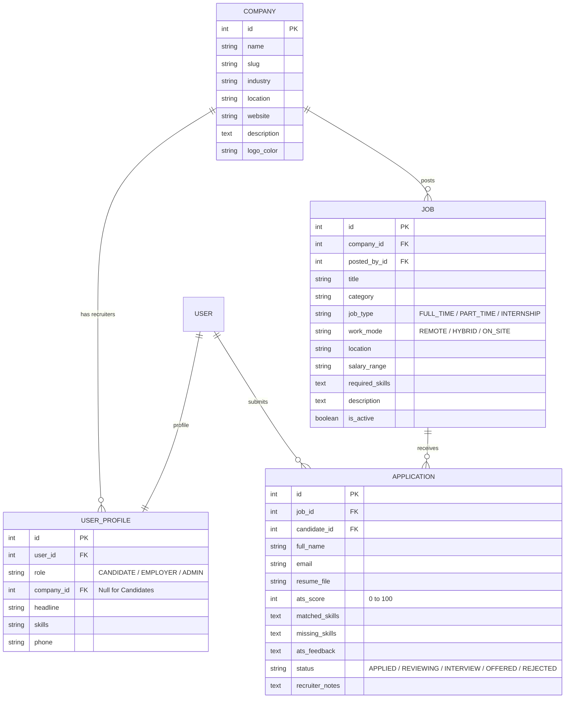

# TalentSphere: Multi-Tenant Job Portal with ATS Engine
**Second-Year College Academic Project Manual & Viva Guide**

---

## 🚀 1. Quick Start Guide (How to Run)

### Step 1: Start the Development Server
Open your terminal or PowerShell in `c:\TUTIORALS` and run:
```powershell
& .\myenv\Scripts\python.exe manage.py runserver
```
Then open your browser at: **[http://127.0.0.1:8000/](http://127.0.0.1:8000/)**

---

## 🔑 2. Ready-to-Use Demo Credentials

The database has already been pre-seeded with realistic companies, recruiters, candidates, and jobs. You can log in using:

| Role | Username | Password | Organization / Tenant | Features Accessible |
| :--- | :--- | :--- | :--- | :--- |
| **Employer / HR** | `technova_hr` | `password123` | **TechNova Solutions** | Post/Edit Jobs, ATS Candidate Pipeline, Rank Candidates by ATS Score |
| **Employer / HR** | `cloudscale_hr` | `password123` | **CloudScale Systems** | CloudScale Tenant Portal, Candidates for CloudScale |
| **Candidate** | `rahul_dev` | `password123` | *Job Seeker* | Browse All Jobs, Upload Resume, View Live ATS Score Breakdown |
| **Candidate** | `priya_qa` | `password123` | *Job Seeker* | QA Specialist Profile, Application Status Tracking |
| **Superadmin** | `admin` | `admin123` | *Platform-wide* | Full Django Admin Access at `/admin/` |

> 💡 **Tip**: On the login page (`/login/`), there are **1-click autofill buttons** for each role to demonstrate the portal quickly in viva/presentations!

---

## 🏢 3. Multi-Tenant Architecture (Explained for Viva)

### What is Multi-Tenancy?
Multi-tenancy is an architecture in which a single software instance serves multiple distinct customer organizations (tenants). In this application:
- **Tenant Entity**: The `Company` model (`TechNova Solutions`, `CloudScale Systems`, `NexGen HealthTech`).
- **Tenant Isolation**: Each Employer user belongs to a specific `Company`. When an employer logs into the portal:
  ```python
  # Multi-tenant query isolation in views.py:
  company = request.user.profile.company
  company_jobs = Job.objects.filter(company=company)
  applicants = Application.objects.filter(job__company=company)
  ```
  Company A’s recruiters can **never** view, edit, or tamper with Company B’s job postings or applicant resumes.
- **Aggregated Marketplace**: Candidates experience a unified job board where they can search across all company tenants simultaneously.
- **Tenant Public Showcase**: Each tenant has a dedicated public page at `/company/<slug>/` showcasing their bio and active jobs.

---

## 🤖 4. Automated ATS (Applicant Tracking System) Engine

### How Does the ATS Algorithm Work?
When a candidate submits an application with their resume (`.pdf`, `.docx`, or `.txt`), the ATS engine (`jobs/ats_engine.py`) performs real-time automated scoring:

$$\text{ATS Score} = \text{Skill Match (50\%)} + \text{Text Similarity (30\%)} + \text{Education \& Experience Signals (20\%)}$$

1. **Resume Text Extraction**: Uses `pypdf` to extract text from PDF files, and XML parsers for Word documents.
2. **Skill Overlap (50%)**:
   - Compares the candidate's resume against the job's required skills from a catalog of 150+ IT and engineering skills (Python, Django, MySQL, React, AWS, Docker, etc.).
   - Computes matched skills (shown in green) and missing skills/gaps (shown in red).
3. **Keyword Frequency & Context Similarity (30%)**:
   - Strips stop words and analyzes the frequency of core domain terms from the job description found inside the candidate's resume.
4. **Signals for Education & Experience (20%)**:
   - Detects academic degree keywords (`B.Tech`, `BE`, `BCA`, `MCA`, `Degree`) and experience tokens (`project`, `developed`, `built`, `experience`).
5. **Recruiter Ranking**:
   - In the ATS Pipeline (`/employer/applicants/`), candidate applications are **automatically ranked from highest to lowest ATS score**, allowing recruiters to immediately identify top candidates.

---

## 🌐 5. Free External API Integration

- **Endpoint Used**: `https://www.arbeitnow.com/api/job-board-api`
- **Cost**: 100% Free, zero payment, no credit card or API key required.
- **Location in Project**: `jobs/free_api.py` and displayed on `/live-jobs/`.
- **Performance**: Equipped with an in-memory 5-minute cache so pages load in milliseconds while staying fresh with live worldwide remote tech jobs.

---

## 🗄️ 6. Database Schema (MySQL 8.0)

The application is connected to **MySQL 8.0** on port `3304` (`multitenant_job_portal`):



---

## 🎓 7. Common Viva / Interview Questions & Answers

**Q1: How did you implement Multi-Tenancy without making it overly complex?**  
> *Answer*: "We implemented logical tenant isolation at the database layer using a `Company` foreign key on the `Job` and `UserProfile` models. Employers are mapped to a specific company tenant upon registration. In our Django views, all employer queries are strictly scoped using `filter(company=request.user.profile.company)`, ensuring strict data isolation between companies while sharing a single unified database."

**Q2: What happens when a student uploads a PDF resume?**  
> *Answer*: "The file is received by the Django view and passed into our `jobs/ats_engine.py` service. We use `pypdf` to parse the text layer, match technical keywords against our pre-indexed skill taxonomy and the job's required skills, calculate the match percentage (0-100%), identify missing skills, and save the ATS score alongside the application record."

**Q3: Why did you choose MySQL instead of SQLite?**  
> *Answer*: "MySQL 8.0 provides production-grade relational integrity, proper foreign key enforcement, multi-user concurrency, and ACID transactions, which are essential for a multi-tenant business application."

**Q4: Which free API did you integrate?**  
> *Answer*: "We integrated the ArbeitNow Job Board REST API (`https://www.arbeitnow.com/api/job-board-api`), which provides real-time global tech job listings without requiring paid subscription keys. We implemented an in-memory caching layer in Python to ensure fast response times."

